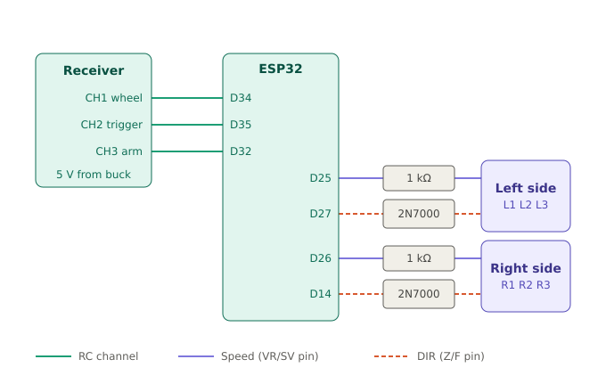

# eksi6 — 6x6 hoverboard-motor chassis

Six-wheel skid-steer chassis driven by six hoverboard hub motors, each with its own hall-sensor BLDC controller.
An ESP32 is the chassis brain. First tests use a HOTRC DS-600 radio; later a fully custom remote (ESP32 + joysticks/buttons, 3D-printed industrial-style housing) replaces it.



## Repository layout

```
eksi6/
├── docs/
│   ├── 01-first-test-wiring.md     wiring plan with diagrams and pin tables
│   ├── 02-bill-of-materials.md     what to buy / have on the bench
│   ├── 03-roadmap.md               phases: first test → custom remote → housing → companion computer
│   ├── diagrams/                   SVG wiring diagrams (power, signals, DIR switch)
│   └── pdf/                        printable / tablet assembly guide
├── firmware/
│   ├── chassis_esp32/              main chassis firmware (ESP32-WROOM-32, DAC speed outputs)
│   └── chassis_esp32s3/            same firmware for ESP32-S3 (PWM + RC filter speed outputs)
├── remote/                         custom remote (planned)
├── hardware/                       CAD, 3D-print files, perfboard layouts (planned)
└── tools/                          sources used to build the PDF
```

## System overview

```
 HOTRC DS-600 ))) F-06A receiver ──PWM──► ESP32 ──speed + DIR──► 3 left controllers  ──► 3 left motors
                                                 └─speed + DIR──► 3 right controllers ──► 3 right motors
```

- **Skid steer:** left = throttle + steering, right = throttle − steering.
- **Safety in firmware:** ARM switch (CH3), speed ramping, stop-and-pause before reversing, failsafe stop after 100 ms without radio signal, `MAX_OUT` top-speed limit.

## Quick start

1. Read [docs/01-first-test-wiring.md](docs/01-first-test-wiring.md) or open the PDF in `docs/pdf/` on a tablet.
2. Arduino IDE → install the **esp32 by Espressif** board package (core 3.x).
3. Open `firmware/chassis_esp32/chassis_esp32.ino`, board **ESP32 Dev Module**, upload.
4. Serial Monitor at 115200 baud shows the channel values, ARM state and output per side.
5. Follow the test sequence in the wiring doc: wheels off the ground first.

## Status

- [x] Motors and controllers mounted
- [x] Wiring plan, diagrams, first-test firmware
- [ ] Controller terminal labels confirmed (VR/SV, Z/F, EL, BK)
- [ ] First bench test (one motor, potentiometer)
- [ ] Full chassis test on stands
- [ ] Custom remote (ESP-NOW)
- [ ] 3D-printed remote housing
