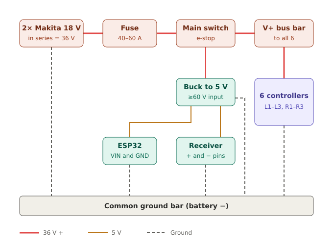
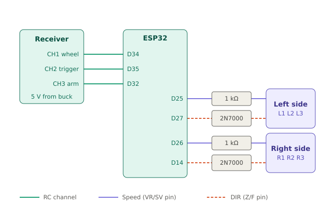
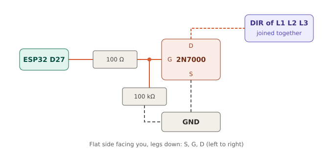

# First test wiring — HOTRC DS-600 → ESP32 → 6 BLDC controllers

**Chassis board:** ESP32-WROOM-32 DevKit, 30-pin, CP2102, USB-C, on a screw-terminal expansion board. It has a DAC on GPIO25/26, so the speed signals need no filters.
**Firmware:** [`firmware/chassis_esp32`](../firmware/chassis_esp32/chassis_esp32.ino)
**Fallback board:** ESP32-S3-DevKitC-1 → [`firmware/chassis_esp32s3`](../firmware/chassis_esp32s3/chassis_esp32s3.ino) (see the end of this page).

## Why the ESP32 sits in between

- The receiver outputs servo PWM (50 Hz, 1000–2000 µs). The controllers want an analog throttle (≈0.8–4.2 V) plus a DIR pin, so wiring the receiver directly does not work.
- Skid steer needs mixing, safe reversing (stop → pause → flip DIR) and a failsafe. The ESP32 does all of that and later becomes the receiver for the custom remote.
- The Raspberry Pi Zero W and Orange Pi Zero are **not** used for motor control (Linux, slow boot, not real-time). They may come later as a companion computer over UART.

## Layout

- **Left side:** controllers L1, L2, L3 share one speed wire and one DIR wire.
- **Right side:** R1, R2, R3 share the other pair.

## 1 · Power and ground



| From | To | Notes |
|---|---|---|
| Battery: 2× Makita 18 V 5 Ah in series (A1 + → bus, A1 − → B1 +, B1 − → ground) | See [06-power-system.md](06-power-system.md) | 36 V nominal, 42 V full |
| Battery + | Fuse 40 A → main switch / e-stop → V+ bus bar → V+ of all 6 controllers | ≥12 AWG main, ≥14 AWG per controller |
| Battery − | Ground bar → V− of all 6 controllers | Same gauge |
| After main switch | 5 V buck converter, ≥60 V input | Set to 5.0 V **before** connecting anything |
| Buck 5 V / GND | ESP32 VIN / GND, receiver + / − | |
| Controller signal GND (each) | Ground bar | Required, otherwise the throttle signal floats |
| Controller 5 V outputs | Leave unconnected | Never join several regulators together |
| + bus → 100 kΩ → **D36** → 6.8 kΩ → GND | Battery total voltage | + 100 nF from D36 to GND |
| Middle of the two packs → 100 kΩ → **D39** → 6.8 kΩ → GND | Lower pack voltage | + 100 nF from D39 to GND |

## 2 · Signals



| ESP32 pin | Connects to | Function |
|---|---|---|
| D34 | Receiver CH1 signal | Steering wheel |
| D35 | Receiver CH2 signal | Throttle trigger |
| D32 | Receiver CH3 signal | ARM switch |
| D33 | Receiver CH4 signal | Turtle / rabbit switch |
| D25 (DAC) | 1 kΩ → SPEED (VR/SV) of L1, L2, L3 joined | Left speed |
| D27 | DIR switch → DIR (Z/F) of L1, L2, L3 joined | Left direction |
| D26 (DAC) | 1 kΩ → SPEED of R1, R2, R3 joined | Right speed |
| D14 | DIR switch → DIR of R1, R2, R3 joined | Right direction |
| D36 (VP) | Battery divider, total | Low-voltage protection |
| D39 (VN) | Battery divider, middle | Per-pack protection |
| VIN / GND | Buck 5 V / ground bar | Power |

All 8 signal pins are on one header row of the 30-pin board. Leave the brake pin unconnected for now. If the controller has an EN/STOP pin, wire it as labelled (often to GND to run).

## 3 · DIR switch — build twice (D27 → left, D14 → right)



```
                                  DIR of L1+L2+L3 (joined)
                                        ▲
                                        │ D (drain)
 ESP32 D27 ──[100 Ω]──●────── G ──► [ 2N7000 ]
                      │                 │ S (source)
                   [100 kΩ]             │
                      │                 │
                     GND ───────────── GND
```

- ESP32 pin HIGH → transistor ON → DIR pulled to GND → that side reverses.
- The 100 kΩ keeps the transistor off while the ESP32 boots.
- 2N7000 pinout: flat side facing you, legs down → **S · G · D** from left to right.

## Mounting

- ESP32 on its screw-terminal expansion board.
- The resistors and both 2N7000s go on a small perfboard next to it.
- For the first test on stands, a breadboard with jumper wires is fine.

## Test sequence

1. **Bench test one controller.** One motor, wheel in the air, 10 kΩ pot as throttle (ends to the controller's 5 V/GND, wiper to SPEED). Note the start voltage → `V_START`. Check that DIR to GND reverses the motor.
2. **Receiver + ESP32 on USB only.** Bind the transmitter, open Serial Monitor at 115200, check CH1–CH4 read ≈1000–2000, and find which switches are CH3 (ARM) and CH4 (turtle/rabbit).
3. **Left side on stands,** in turtle mode. Flip ARM with the trigger centred, pull gently.
4. **Fix directions** with `INVERT_L` / `INVERT_R`.
5. **Add the right side,** check steering.
6. **Smoothness check:** full trigger and release in turtle and rabbit; tune `ACCEL_KMH_S`, `DECEL_KMH_S`, `JERK_KMH_S2`.
7. **Failsafe test:** transmitter off while running → smooth stop within ~2.5 s (the e-stop cuts power instantly).
8. **On the ground:** empty first, then with a load.

## Safety

- Wheels off the ground until directions and failsafe are confirmed.
- Physical e-stop in the battery + line, always reachable.
- Never flip DIR at speed (the firmware already prevents it).

## Fallback: ESP32-S3-DevKitC-1

The S3 has no DAC, so speed is 20 kHz PWM smoothed by an RC filter (4.7 kΩ in series, 4.7 µF to GND) per side.

| Function | S3 pin |
|---|---|
| CH1 / CH2 / CH3 / CH4 | GPIO4 / GPIO5 / GPIO6 / GPIO18 |
| Speed left / right (PWM → filter) | GPIO7 / GPIO15 |
| DIR left / right | GPIO16 / GPIO17 |
| Battery total / middle | GPIO1 / GPIO2 |

Avoid GPIO0, 3, 45, 46 (boot), 19/20 (USB), 26–37 (flash/PSRAM), 43/44 (UART0). Needs Arduino-ESP32 core 3.x.
