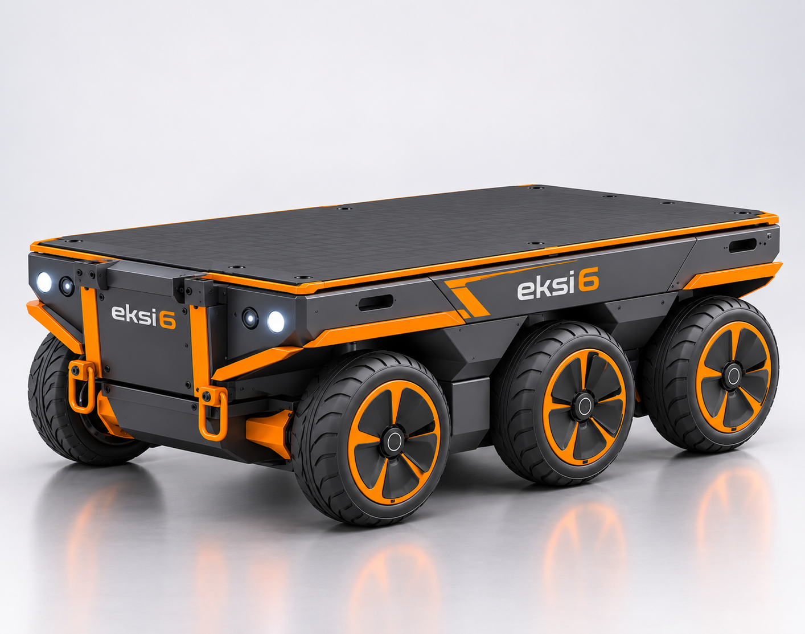
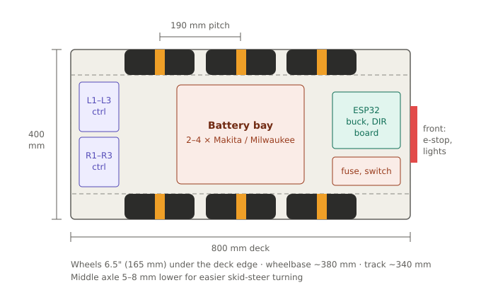

# Design brief — eksi6 six-wheeled cargo platform



*Concept render (ChatGPT): flat anti-slip deck with tie-down holes, grey body, orange edge trims, bumper bars and wheel rims, front lights, tow rings, eksi6 branding.*

## Requirements

| Item | Decision |
|---|---|
| Purpose | Cargo platform: carry all kinds of goods |
| Deck | **400 × 800 mm**, completely flat, nothing sticking out above it |
| Wheels | 6× hoverboard hub-motor wheels (probably 6.5″, to measure), 3 per side, skid steer |
| Colours | **Grey** body, **orange** accents (trim, bumpers, rims) |
| Look | Industrial, like professional material-handling equipment (see concept) |
| Speed | **Max 5 km/h.** Turtle ~2.5 km/h, rabbit ~5 km/h, smooth start/stop ([05](05-speed-and-torque.md)) |
| Priority | **Maximum torque at low speed** |
| Power | 2–4× Makita 18 V (36 V), later Milwaukee M18 ([06](06-power-system.md)) |

## Top layout (proposal)



```
  rear                                                         front
  ┌──────────────────────────────────────────────────────────────┐
  │        ███▌██     ███▌██     ███▌██      ◄ wheels L1 L2 L3      │
  │ ┌─────┐       ┌──────────────────┐    ┌────────┐              │▌ e-stop
  │ │L ctrl│      │   BATTERY BAY    │    │ ESP32  │              │▌ lights
  │ ├─────┤       │ 2–4 × 18 V packs │    │ buck   │              │▌
  │ │R ctrl│      └──────────────────┘    │ fuse   │              │
  │ └─────┘                               └────────┘              │
  │        ███▌██     ███▌██     ███▌██      ◄ wheels R1 R2 R3      │
  └──────────────────────────────────────────────────────────────┘
            ◄──── 800 mm ────►                     ▲ 400 mm
```

## Skid-steer geometry: important for turning

A 6-wheel skid steer turns by dragging its wheels sideways. The longer the wheelbase compared with the track width, the harder (and more torque-hungry) it turns.

| Layout | Wheelbase (front–rear axle) | Track (left–right) | Ratio | Turning |
|---|---|---|---|---|
| Wheels spread to the deck ends (like the concept render) | ~600 mm | ~340 mm | 1.8 | heavy, scrubs tyres |
| **Wheels close together, 190 mm pitch (proposal)** | **~380 mm** | **~340 mm** | **1.1** | **good** |
| Wheels outside the body (wider track) | ~380 mm | ~460 mm | 0.8 | best, but wheels stick out |

Recommendations:
- Keep the 3 wheels per side **close together** (about 190 mm pitch for 165 mm wheels). The deck overhangs front and rear by about 130 mm.
- Mount the **middle axle 5–8 mm lower** than the front and rear. The platform then turns on its middle wheels, which is a common trick on 6×6 robots.
- The concept's look (bumpers, side trims, orange rims) still works; only the wheel spacing changes.

## Design rules that follow from the flat top

- Everything (battery, ESP32, controllers, buck converter, wiring) lives **under** the deck.
- E-stop, main switch, charge/battery access, lights and status LED go on the **front or side panels**, never on top.
- Battery packs slide in from the **side or rear**.
- The receiver antenna and, later, the ESP-NOW antenna go on a side panel.
- Wheels stay inside the deck footprint or flush with it, so goods can overhang without touching the tyres.
- Tie-down points along the deck edges (as in the concept).

## Open points

- Max payload in kg
- Ground clearance
- Deck material (aluminium sheet, plywood with an anti-slip coating, or a composite top)
- Final wheel spacing (after measuring the wheels)
