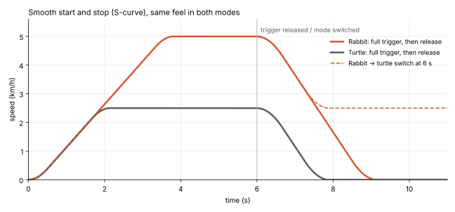

# Speed and torque — turtle / rabbit

## Requirement

- **Top speed: 5 km/h**, never more.
- **Two modes** on a switch, like on a lawnmower:
  - 🐢 **Turtle: ~2.5 km/h** for heavy loads, slopes and precise manoeuvring
  - 🐇 **Rabbit: ~5 km/h** for driving empty or lightly loaded
- **Goal: maximum pushing force (torque) at low speed.**

## Smooth start and smooth stop (all modes)

Heavy loads must never jerk. The firmware uses an **S-curve motion profile**: the acceleration itself builds up and fades out gradually, so there is no bump when starting, stopping, or switching turtle ↔ rabbit.



| Situation | Time (default tuning) |
|---|---|
| 0 → 2.5 km/h (turtle, full trigger) | ~2.1 s |
| 0 → 5 km/h (rabbit, full trigger) | ~3.8 s |
| 2.5 → 0 (release trigger) | ~1.8 s |
| 5 → 0 (release trigger) | ~3.1 s |
| Rabbit → turtle while driving | ~1.8 s, smooth |
| Radio lost / disarmed at 5 km/h | ~2.5 s, firm but smooth |
| **E-stop button** | **Instant**: cuts battery power |

```
 speed
  5 ┤            ╭──────────╮            rabbit
    │          ╱              ╲
2.5 ┤      ╭──╱───╮            ╲         turtle
    │    ╱  ╱      ╲            ╲
  0 ┼──╯──╯         ╰──          ╰──
    └─────────────────────────────────► time
       soft start      soft stop
```

Tuning in `firmware/chassis_esp32/chassis_esp32.ino`:

| Setting | Default | Effect |
|---|---|---|
| `ACCEL_KMH_S` | 1.5 | Max acceleration (lower = gentler start) |
| `DECEL_KMH_S` | 2.0 | Max deceleration when releasing the trigger |
| `JERK_KMH_S2` | 3.0 | How softly acceleration builds and fades (lower = softer, longer) |
| `FAILSAFE_DECEL_KMH_S` | 5.0 | Stop on signal loss / disarm |

The same km/h-based profile is used in both modes. The turtle simply has a lower target, so it feels just as soft.

**Note on stopping:** these controllers usually coast when the throttle goes to zero. On a slope with a heavy load the platform could roll, so the brake pin is on the to-do list.

## What sets the torque in a hoverboard hub motor

Hoverboard motors are **direct drive**: no gearbox. So, unlike a lawnmower, slowing down does **not** multiply the torque by itself.

```
 torque per wheel  =  motor constant  ×  current
                                          ▲
                        limited by the controller's current limit
```

- Torque comes from **current**, and the controller's **current limit** caps it.
- At low speed the motor has little back-EMF, so the controller can push its full current at any speed below 5 km/h.
- Six motors add up: 6 × the torque of one wheel.

What turtle and rabbit do in practice:
1. **Limit the top speed.** This makes the platform safe and controllable.
2. **Keep the full current available.** The trigger controls speed, not force.
3. **Later: hold the speed under load (closed loop).** The ESP32 measures wheel speed and adds throttle when the load slows the wheels, up to the controller's current limit. That is how full torque is delivered on a slope or with a heavy load.

## Wheel speed table

| Wheel (hoverboard) | Diameter | 2.5 km/h | 5 km/h |
|---|---|---|---|
| 6.5″ | ~165 mm | ~80 rpm | ~160 rpm |
| 8″ | ~200 mm | ~66 rpm | ~133 rpm |
| 10″ | ~254 mm | ~52 rpm | ~104 rpm |

Formula: rpm = (km/h × 1000 / 60) / (π × diameter in m)

## Phase 1: open loop (in firmware now)

```
 CH4 switch ──► turtle: target 0 .. 2.5 km/h
            └─► rabbit: target 0 .. 5 km/h
 trigger 0..100 % ──► target km/h ──► S-curve ──► km/h → throttle (OUT_AT_RABBIT) ──► DAC ──► controllers
```

- Receiver **CH4 → ESP32 D33** (S3: GPIO18).
- Speed still drops somewhat under heavy load, because there is no feedback yet.

**Calibration on stands:** put a tape mark on a wheel and count its turns in 30 s (or use a phone tachometer app). Adjust `OUT_AT_RABBIT` until full trigger in rabbit gives 5 km/h (≈160 rpm on a 6.5″ wheel). Turtle follows automatically at half of that.

## Phase 2: closed loop (next firmware step)

```
              target speed (turtle 2.5 / rabbit 5 km/h × trigger)
                        │
                        ▼
                 ┌─────────────┐   throttle    ┌────────────┐
                 │ ESP32 PI    │──────────────►│ controller │──► motor
                 │ controller  │               └────────────┘      │
                 └─────────────┘                                   │
                        ▲          measured wheel speed            │
                        └──────── hall pulses / speed output ◄─────┘
```

- **Feedback source:** the controller's speed-pulse output (often labelled P, SC or SPEED OUT), if it has one. Otherwise, tap one hall-sensor line of the middle motor on each side through a voltage divider (the hall signals are 5 V).
- **Hall rate:** a hoverboard motor gives about 90 hall edges per wheel turn, so 160 rpm ≈ 240 Hz, easy for the ESP32.
- **Hard limit:** the ESP32 never commands more than 5 km/h, even at full trigger.

## Things to check on the controllers

- **Current limit.** It sets the maximum torque. Check the label or datasheet; some controllers have a shunt or a setting.
- **Speed-pulse output pin.** Needed for phase 2.
- **Heat.** Long periods of high current at low speed heat the motors and controllers. Watch temperatures during the first loaded tests.
