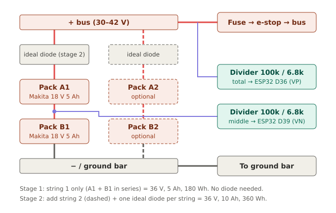

# Power system — Makita now, Milwaukee later

## Decision

- **Power tool batteries**, not a fixed hoverboard pack, so the platform stays flexible.
- **Start:** 2× Makita LXT 18 V 5 Ah in series → **36 V**, the native voltage of the hoverboard motors and controllers.
- **More range:** 4 packs as 2 parallel strings (2S2P) → 36 V, 10 Ah.
- **Next model (if the prototype succeeds):** Milwaukee M18. It is also an 18 V / 5-cell pack, so the same electronics work and only the battery adapters change.

## Wiring



```
 Stage 1 (now)                         Stage 2 (more range)
 ┌─────────────┐                       ┌─────────────┐  ┌─────────────┐
 │ Makita A1   │ +                     │ A1          │  │ A2          │
 │ 18 V 5 Ah   │──► + bus              │ 18 V        │  │ 18 V        │
 └──────┬──────┘                       └──────┬──────┘  └──────┬──────┘
        │ (middle → ESP32 D39)                │                │
 ┌──────┴──────┐                       ┌──────┴──────┐  ┌──────┴──────┐
 │ Makita B1   │                       │ B1          │  │ B2          │
 │ 18 V 5 Ah   │──► − / ground         │ 18 V        │  │ 18 V        │
 └─────────────┘                       └──────┬──────┘  └──────┬──────┘
                                              ▼                ▼
                                      ideal diode 1      ideal diode 2
                                              └───────┬────────┘
                                                   + bus
```

| Setup | Voltage | Capacity | Energy |
|---|---|---|---|
| 2 packs, 2S | 36 V nominal · 42 V full · 30 V empty | 5 Ah | 180 Wh |
| 4 packs, 2S2P | same | 10 Ah | 360 Wh |

## Rules

1. **Always pair packs of the same capacity and charge level** in one string. Charge both packs of a string together.
2. **Two strings in parallel need an ideal-diode module per string** (MOSFET type, ≥60 V, ≥30 A). It stops a full string from dumping current into an empty one. Plain diodes also work but waste power and get hot.
   - Tip: fit the diode on string 1 from day one. Adding string 2 is then just plugging it in.
3. **Fuse after the batteries:** 40 A to start, a main switch/e-stop after it, as in the wiring plan.
4. **Low-voltage protection is the ESP32's job.** Makita/Milwaukee packs normally rely on the tool to cut off when empty, so outside a tool they can be over-discharged and damaged. The firmware watches each pack:

| Per pack (5 cells) | Per cell | Firmware action |
|---|---|---|
| > 16.0 V | > 3.2 V | normal |
| < 16.0 V | < 3.2 V | **turtle only** (rabbit disabled) |
| < 15.0 V | < 3.0 V | **smooth stop, driving locked** |
| > 15.8 V | | unlocked again (after swapping packs) |

## Voltage sensing

```
 + bus ──[100 kΩ]──┬──► ESP32 D36 (VP)        middle of string 1 ──[100 kΩ]──┬──► ESP32 D39 (VN)
                   │                                                         │
                [6.8 kΩ]                                                  [6.8 kΩ]
                   │                                                         │
                  GND                                                       GND
```

- 42 V full → 2.67 V at the pin, safe for the ESP32 (max 3.3 V).
- D36/D39 are input-only ADC1 pins: they work with Wi-Fi/ESP-NOW active.
- Add a 100 nF capacitor from each pin to GND against motor noise.
- **Without dividers** (bench test on USB) the firmware prints `NO-BATT-SENSE` and allows turtle only.
- **Check against a multimeter** once and adjust `DIV_RATIO` if the reading is off by more than 0.3 V.
- On the ESP32-S3 the pins are GPIO1 (total) and GPIO2 (middle).

## Battery adapters

- Use Makita LXT and Milwaukee M18 **battery adapter docks** (18 V, with ≥12 AWG leads) mounted in a 3D-printed battery bay.
- Make the bay's adapter plates **swappable**: same mounting holes and same output connector (XT60/XT90) for Makita and Milwaukee.
- Packs slide in from the **side or rear**, so the flat top deck stays free.

## Run-time estimate (rough, to be measured)

At 5 km/h on flat ground the platform probably uses about 100–200 W depending on load. That would give roughly 1–1.5 h on 2 packs and 2–3 h on 4 packs. **Measure it in the first real test.**

## Things to check

- **Controller undervoltage cutoff.** Some 36 V controllers cut out at 31–33 V. If that's higher than the firmware cutoff, the controllers stop first (safe, but abrupt).
- **Pack type.** Makita BL1850B (5 Ah) is fine for ~40 A peaks. Avoid cheap clone packs at high current.
